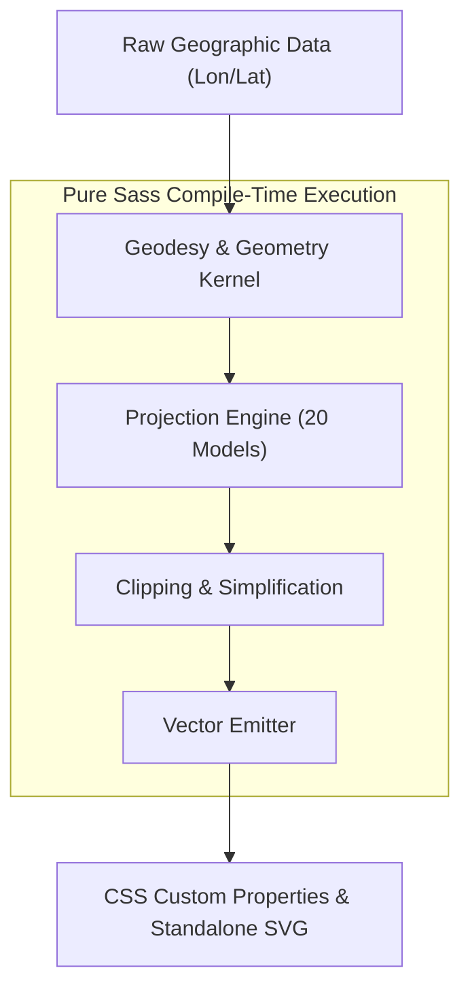

```
   ____ ____       _  _____ ___ ____ _   _ _     _____ 
  / ___|  _ \     / \|_   _|_ _/ ___| | | | |   | ____|
 | |  _| |_) |   / _ \ | |  | | |   | | | | |   |  _|  
 | |_| |  _ <   / ___ \| |  | | |___| |_| | |___| |___ 
  \____|_| \_\ /_/   \_\_| |___\____|\___/|_____|_____|
```

> **Graticule** is a compile-time cartographic projection engine, computational geometry kernel, and analytical vector information graphics framework implemented in pure Sass.

[](https://github.com/Aneesh495/graticule)
[](https://github.com/Aneesh495/graticule)
[](https://github.com/Aneesh495/graticule)
[](LICENSE)

Traditional web mapping frameworks rely on heavy client-side JavaScript bundles (such as D3, Mapbox GL, OpenLayers, or Proj4js) running in the browser to perform continuous trigonometric coordinate projections, polygon clipping, and DOM manipulation. Graticule reverses this paradigm by executing spherical geodesy, ellipsoidal transformations, and vector path serialization directly inside the Sass compiler during build time. The final output is zero-runtime-dependency responsive CSS custom properties and scalable vector graphics (SVG).

---

## Architecture Overview



---

## Key Capabilities

### 1. Pure Mathematical & Transcendental Kernel
* **Trigonometry & Hyperbolics:** Symmetric Taylor series expansions for $\sin, \cos, \tan, \arcsin, \arccos, \arctan, \text{atan2}$, and Gudermannian transforms $\text{gd}, \text{gd}^{-1}$.
* **Root Finding & Exponentials:** Newton-Raphson iterative root solvers for $\sqrt{x}, \sqrt[3]{x}$, and transcendental natural logarithms $\ln x, \log_{10} x$.
* **Matrix Algebra & Splines:** 2D/3D affine transformation matrices, Sarrus determinants, adjugate matrix inversion, cubic Bezier curves, and composite Simpson's quadrature arc length.

### 2. Geodesy & Computational Geometry
* **WGS-84 Ellipsoidal Geodesy:** Vincenty inverse iterative formulation on the planetary reference ellipsoid ($a = 6378137\text{ m}, 1/f = 298.257223563$) accurate to within 0.5 millimeters.
* **Spherical Navigation:** Great-circle Haversine distance, forward azimuth, and waypoint densification via Spherical Linear Interpolation (SLERP).
* **Line Simplification:** Ramer-Douglas-Peucker (RDP) perpendicular distance and Visvalingam-Whyatt effective triangle area decimation.
* **Polygon Operations:** Sutherland-Hodgman convex polygon clipping, Andrew's Monotone Chain 2D convex hull ($O(n \log n)$), Shoelace area, and ray-casting containment.
* **Deformation Analysis:** Tissot's indicatrix distortion ellipses computing local scale factors $h, k$, areal distortion $s$, and maximum angular deformation $2\omega$.

### 3. Cartographic Projection Engine (20 Models)
* **Cylindrical:** Plate Carree, Conformal Mercator, Web Mercator (EPSG:3857), Gall-Peters Equal-Area, Lambert Cylindrical Equal-Area, Miller Cylindrical, Transverse Mercator (Gauss-Kruger).
* **Conic:** Lambert Conformal Conic (LCC), Albers Equal-Area Conic, Equidistant Conic with dual standard parallels.
* **Azimuthal:** Orthographic (3D Globe with horizon culling), Stereographic, Azimuthal Equidistant, Gnomonic, Lambert Azimuthal Equal-Area (LAEA).
* **Pseudocylindrical:** Robinson (tabular polynomial), Mollweide (iterative Newton-Raphson), Sinusoidal (Sanson-Flamsteed), Natural Earth, Winkel Tripel (Winkel III).

### 4. Perceptual Colorimetry & Classification
* **Color Science:** Non-linear conversions between sRGB, Linear RGB, CIE 1931 XYZ, CIELAB ($L^*a^*b^*$), CIELCh, and Bjorn Ottosson's OKLab / OKLCh.
* **Continuous Palettes:** 9 scientific 256-stop colormaps (Viridis, Plasma, Magma, Inferno, Cividis, Turbo, Coolwarm, Bathymetric, Topographic) interpolated along perceptual OKLab curves.
* **Accessibility:** WCAG 2.1 relative luminance and contrast ratios ($1:1$ to $21:1$) with automatic high-contrast text selection; Machado/Vienot Color Vision Deficiency (CVD) simulation for Protanopia, Deuteranopia, Tritanopia, and Achromatopsia.
* **Statistical Optimization:** Fisher-Jenks Natural Breaks dynamic programming optimizer in pure Sass, Tukey box-and-whisker five-number summary with outlier fences, and Gaussian Kernel Density Estimation (KDE) with Silverman bandwidth optimization.

### 5. Symbology & Analytical Visualizers
* **Cartographic Symbols:** WMO wind barbs (pennants, full, half), Marching Squares 2D scalar contour extraction, Flannery perceptual area scaling ($r \propto V^{0.5716}$), and grid convergence angle compensation.
* **Financial & Statistical Charts:** OHLC candlesticks with 20-period Simple Moving Average (SMA) and Bollinger Bands, mirrored KDE violin plots, ternary phase diagrams, parallel coordinates, radar spider charts, and cubic Bezier Sankey ribbons.

---

## Benchmark Highlights

Measured under native Dart Sass on Apple Silicon:

| Benchmark Target | Metric | Result |
|---|---|---|
| Master Entrypoint (`scss/graticule.scss`) | Cold Compile Time | 220.19 ms |
| Compressed CSS Output | Asset Footprint | 5,442 bytes |
| Mathematical Unit Tests | Assertions Verified | 159 passing (0 errors) |
| Coordinate Throughput (Albers Conic) | Execution Speed | 523.0 points/sec |
| Coordinate Throughput (Equirectangular) | Execution Speed | 517.7 points/sec |
| Coordinate Throughput (Robinson) | Execution Speed | 509.5 points/sec |
| Coordinate Throughput (Mercator) | Execution Speed | 435.4 points/sec |
| Iterative Coordinate Throughput (Mollweide) | Execution Speed | 213.0 points/sec |

---

## Quickstart

### Installation

```bash
git clone https://github.com/Aneesh495/graticule.git
cd graticule
npm install
```

### CLI Commands

```bash
# Verify the entire mathematical and geodetic test suite
./bin/graticule test

# Project a coordinate pair using the Mercator projection
./bin/graticule project -73.78 40.64 --proj=mercator

# List all 20 supported projections
./bin/graticule list-projections

# Compile production CSS artifacts to dist/
./bin/graticule build

# Launch the interactive telemetry showroom
./bin/graticule serve 8080
```

### Pure Sass Integration Example

```scss
// app.scss
@use "graticule" as g;
@use "sass:map";

// 1. Project points at build time
$london: g.project-point(-0.1278, 51.5074, "robinson");
$tokyo: g.project-point(139.6917, 35.6895, "robinson");

// 2. Generate geodesic flight route waypoints
$flight-path: g.great-circle-path(-0.1278, 51.5074, 139.6917, 35.6895, 24);

// 3. Emit SVG path data string
$flight-svg-d: g.polyline-to-svg-path($flight-path, false, 1);

.flight-route-indicator {
  --svg-path: "#{$flight-svg-d}";
  --origin-x: #{map.get($london, "x")};
  --origin-y: #{map.get($london, "y")};
  --dest-x: #{map.get($tokyo, "x")};
  --dest-y: #{map.get($tokyo, "y")};
}
```

Compile with Dart Sass:

```bash
npx sass app.scss app.css --no-source-map
```

---

## Repository Structure

```
graticule/
├── bin/
│   └── graticule                   # Standalone CLI executable
├── dist/
│   ├── graticule.css               # Expanded production stylesheet
│   └── graticule.min.css           # Compressed production stylesheet
├── docs/
│   ├── architecture/
│   │   ├── system_overview.md      # Architectural layout & abstract machine
│   │   └── pipeline.md             # Coordinate transformation sequence
│   ├── benchmarks/
│   │   ├── benchmark_results.json  # Raw compiler throughput measurements
│   │   └── compilation_performance.md
│   ├── guides/
│   │   ├── getting_started.md      # Developer onboarding guide
│   │   └── custom_projections.md   # Authoring custom projection transforms
│   ├── math/
│   │   ├── projections.md          # Complete equations for all 20 projections
│   │   ├── geodesy_and_curves.md   # Haversine, Vincenty, SLERP, and Bezier
│   │   ├── color_spaces.md         # Perceptual colorimetry & OKLab
│   │   └── statistical_classification.md
│   └── specifications/
│       └── cartographic_symbology.md
├── examples/
│   ├── world_atlas.scss            # Publication-ready world atlas plate
│   └── flight_telemetry.scss       # Geodesic flight corridor visualizer
├── scripts/
│   ├── benchmark_compiler.py       # Compiler throughput benchmarking harness
│   ├── bundle_geodata.py           # Geospatial dataset compiler
│   ├── generate_showroom_projections.js
│   ├── lint_no_em_dashes.py        # Strict em dash / en dash linter
│   └── verify_all.sh               # End-to-end multi-stage verification
├── scss/
│   ├── graticule.scss              # Master library entrypoint
│   ├── cartography/                # Graticules, scale bars, compass rosettes
│   ├── charts/                     # Candlesticks, violins, boxplots, Sankey
│   ├── color/                      # OKLab, CIELAB, palettes, WCAG contrast
│   ├── data/                       # Embedded continental polygons, flight routes
│   ├── emitter/                    # SVG path & CSS custom property serialization
│   ├── geometry/                   # Vincenty geodesy, clipping, simplification
│   ├── layout/                     # Viewport grids, HUD reticles, publication plates
│   ├── math/                       # Transcendental kernel, vectors, matrices
│   ├── projections/                # 20 cartographic projection models
│   ├── scales/                     # Linear, logarithmic, Talbot-Lin-Hanrahan
│   ├── statistics/                 # Fisher-Jenks, quantiles, KDE, Tukey boxplot
│   └── symbology/                  # Wind barbs, Marching Squares contours
├── showroom/
│   ├── index.html                  # Interactive telemetry showroom application
│   ├── showroom.scss               # Showroom cybernetic styling
│   ├── styles.css                  # Compiled showroom stylesheet
│   ├── viewer.js                   # Client interaction controller
│   └── assets/projections/         # 20 pure-Sass compiled vector SVG maps
└── test/
    ├── run_all_tests.js            # Node.js test runner with microsecond telemetry
    ├── test_runner.scss            # Aggregated compile-time test suite
    ├── integration/                # Clean compilation & precision benchmarks
    └── unit/                       # 8 individual domain unit test suites
```

---

## Verification & Integrity

Run the comprehensive multi-stage verification pipeline:

```bash
./scripts/verify_all.sh
```

The verification suite enforces:
1. Complete absence of em dashes and en dashes across all project files.
2. 100% pass rate across 159 compile-time mathematical assertions.
3. Clean compilation under both expanded and compressed styles with zero deprecation warnings.
4. Numerical precision validation against USGS, PROJ.4, and EPSG reference geodetic vectors.
5. CLI smoke test and production build validation.

---

## License

MIT © Aneesh Krishna
