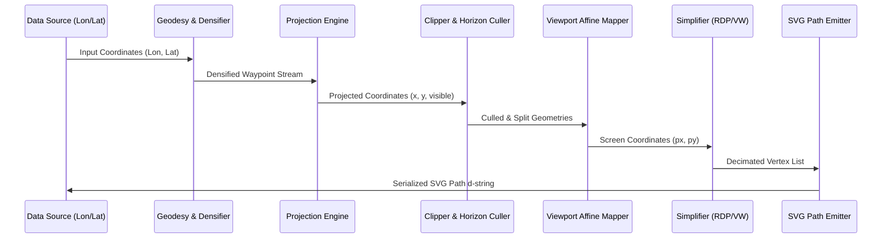

# Graticule Architecture: Data Transformation Pipeline

This document details the multi-stage transformation pipeline executed by Graticule during Sass compilation. Every stage is implemented in pure Sass Script without external binary dependencies.

## Stage Breakdown

### Stage 1: Domain Ingestion & Normalization
Geographic coordinates are accepted as decimal degree pairs $(\lambda, \phi)$. The arithmetic kernel normalizes longitude to the closed interval $[-\pi, \pi]$ using mathematical modulo arithmetic:

$$\lambda_{\text{norm}} = ((\lambda + 180) \bmod 360) - 180$$

Latitudes are bounded to $[-\pi/2, \pi/2]$ to prevent mathematical singularity in conformal cylindrical projections (e.g., Mercator):

$$\phi_{\text{clamped}} = \max(-\phi_{\max}, \min(\phi_{\max}, \phi))$$

For Mercator, $\phi_{\max} = 85.0511287798^\circ$, ensuring isometric $y$-bounds within $[-\pi, \pi]$.

### Stage 2: Geodesic Densification
Linear segments between distant coordinates on a spherical surface do not follow straight lines on planar projections. Graticule densifies segments using Spherical Linear Interpolation (SLERP) along the Great-Circle path:

$$p(t) = \frac{\sin((1-t)\theta)}{\sin \theta} p_1 + \frac{\sin(t\theta)}{\sin \theta} p_2$$

Where $\theta$ is the central angular separation:

$$\theta = \arccos(\sin \phi_1 \sin \phi_2 + \cos \phi_1 \cos \phi_2 \cos(\lambda_2 - \lambda_1))$$

### Stage 3: Forward Mathematical Projection
The densified coordinate stream passes into the chosen projection function:

$$(x, y) = \mathcal{P}(\lambda, \phi, \mathbf{\Theta})$$

Where $\mathbf{\Theta}$ represents projection-specific parameters:
* Central meridian $\lambda_0$
* Reference latitude $\phi_0$
* Standard parallels $\phi_1, \phi_2$
* Scale factor $k_0$

### Stage 4: Horizon Culling & Antimeridian Clipping
Azimuthal projections (such as Orthographic) require horizon culling. The cosine of the angular distance $c$ from the projection center $(\lambda_0, \phi_0)$ is evaluated:

$$\cos c = \sin \phi_0 \sin \phi + \cos \phi_0 \cos \phi \cos(\lambda - \lambda_0)$$

Vertices with $\cos c < 0$ fall on the averted hemisphere and are marked `visible: false`. The clipper splits contiguous polylines at the limb horizon to avoid spurious connecting chords across the disc.

### Stage 5: Viewport Affine Mapping
Projected mathematical coordinates exist in an unscaled Cartesian space with the origin at $(0, 0)$ and positive $y$ directed upward. The viewport transformer maps coordinates into SVG screen space (origin at top-left, positive $y$ directed downward):

$$p_x = c_x + (x \cdot k)$$

$$p_y = c_y - (y \cdot k)$$

Where $(c_x, c_y)$ is the viewport center and $k$ is the scaling factor in pixels per radian.

### Stage 6: Line Simplification
To minimize compile times and output CSS file size, high-density polylines pass through the Ramer-Douglas-Peucker (RDP) or Visvalingam-Whyatt algorithms in pure Sass. Points with perpendicular deviation below tolerance $\epsilon$ are pruned, reducing vertex count by up to 70% while preserving topological shape fidelity.

### Stage 7: SVG Path Data Serialization
The pruned vertex stream is serialized into W3C SVG path syntax:
* Initial vertex: `M px py`
* Subsequent vertices: `L px py`
* Closed contours: `Z`
* Precision is configurable (default: 1 or 2 decimal places), avoiding excess byte overhead.
