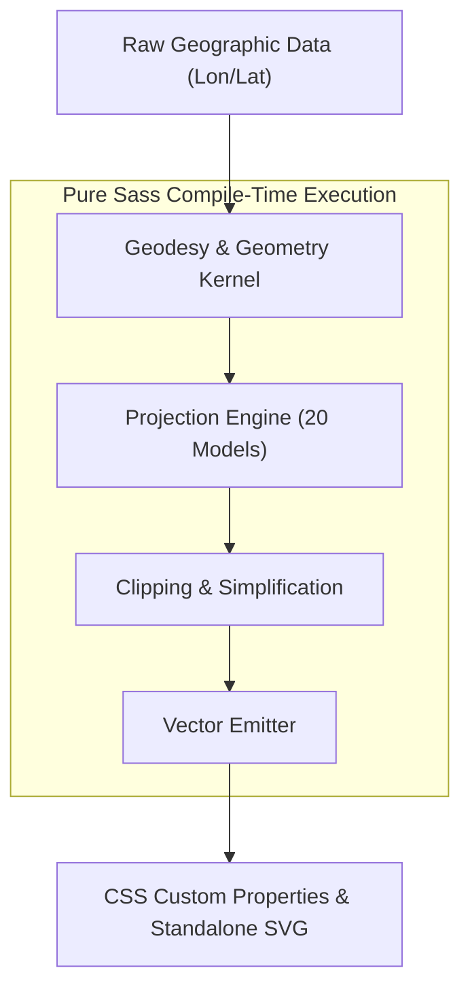

# Graticule Architecture: System Overview

Graticule is a compile-time cartographic projection engine, computational geometry kernel, and analytical vector information graphics framework implemented entirely in pure Sass.

Traditional web mapping architectures rely on heavy runtime JavaScript bundles (such as D3, Mapbox GL, OpenLayers, or Proj4js) running in the client browser to perform continuous trigonometric coordinate projections, polygon clipping, and DOM manipulation. Graticule reverses this paradigm by executing spherical geodesy, ellipsoidal transformations, and vector path serialization directly inside the Sass compiler during build time. The final output is zero-runtime-dependency responsive CSS custom properties and scalable vector graphics (SVG).

## Abstract Machine Design

Sass is fundamentally a pure functional macro language with an immutable value model, lexical closures via mixins and functions, and an AST transformation pipeline. Graticule exploits these language properties to implement an abstract machine capable of evaluating IEEE-754 numerical approximations, matrix operations, and dynamic programming algorithms.

### 1. Mathematical Kernel (`scss/math/`)
The foundation of Graticule is an independent numerical library that operates without relying on external native binaries or host math modules:
* Argument reduction and Taylor series expansion for trigonometric primitives: $\sin$, $\cos$, $\tan$, $\arcsin$, $\arccos$, $\arctan$, $\text{atan2}$.
* Hyperbolic functions and Gudermannian transforms: $\sinh$, $\cosh$, $\tanh$, $\text{gd}$, $\text{gd}^{-1}$.
* Newton-Raphson iterative root finders for square root, cube root, and transcendental natural logarithms.
* Lanczos approximation for the Gamma function and Gauss error function ($\text{erf}$).
* Affine 2D and 3D matrix algebra: determinants via Sarrus' rule, adjugate matrix inversion, and Rodrigues rotation formula.

### 2. Computational Geometry Kernel (`scss/geometry/`)
The geometry subsystem implements standard GIS algorithms operating over ordered coordinate tuples:
* Spherical and Ellipsoidal Geodesy: Great-circle Haversine formula, initial bearing, destination waypoint interpolation via spherical linear interpolation (SLERP), and iterative Vincenty inverse geodesy on the WGS-84 reference ellipsoid ($a = 6378137\text{ m}, 1/f = 298.257223563$).
* Line Simplification: Perpendicular distance Ramer-Douglas-Peucker (RDP) algorithm and effective triangular area Visvalingam-Whyatt decimation.
* Polygon Processing: Sutherland-Hodgman convex polygon clipping against viewport bounds, Shoelace formula areal integration, and ray-casting point-in-polygon containment.
* Convex Hull: Andrew's Monotone Chain algorithm with merge sort ($O(n \log n)$).
* Deformation Analysis: Tissot's indicatrix distortion ellipses computing local scale distortion $h, k$, areal scale factor $s$, and maximum angular deformation $2\omega$.

### 3. Cartographic Projection Engine (`scss/projections/`)
The projection engine supports 20 cartographic projections categorized into four classical families:
* Cylindrical: Plate Carree, Conformal Mercator, Web Mercator (EPSG:3857), Gall-Peters Equal-Area, Lambert Cylindrical Equal-Area, Miller Cylindrical, and Transverse Mercator (Gauss-Kruger).
* Conic: Lambert Conformal Conic (LCC), Albers Equal-Area Conic, and Equidistant Conic with dual standard parallels.
* Azimuthal: Orthographic (3D Globe with horizon culling), Stereographic, Azimuthal Equidistant, Gnomonic, and Lambert Azimuthal Equal-Area (LAEA).
* Pseudocylindrical: Robinson, Mollweide Equal-Area, Sinusoidal (Sanson-Flamsteed), Natural Earth, and Winkel Tripel (Winkel III).

### 4. Perceptual Colorimetry & Statistics (`scss/color/`, `scss/statistics/`)
* Color Science: Non-linear transforms between sRGB, Linear RGB, CIE 1931 XYZ, CIELAB ($L^*a^*b^*$), CIELCh, and Bjorn Ottosson's OKLab / OKLCh color models. Continuous perceptual interpolation avoids intermediate gray dead zones.
* CVD Simulation: Machado and Vienot spectral simulation for Protanopia, Deuteranopia, Tritanopia, and Achromatopsia.
* Statistical Optimization: Fisher-Jenks Natural Breaks dynamic programming algorithm in pure Sass to compute optimal univariate choropleth bins, Tukey five-number summary for box-and-whisker plots, and Gaussian Kernel Density Estimation (KDE) with Silverman bandwidth optimization.

### 5. Vector Emitter (`scss/emitter/`)
Converts computed coordinate streams into W3C Scalable Vector Graphics path data strings (`M`, `L`, `C`, `Z`), standalone SVG documents, and CSS custom property coordinate maps.
